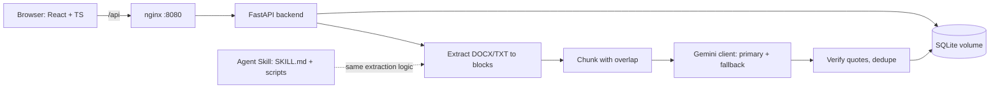

# Document Rule Compliance Checker

Check **DOCX** and **TXT** documents against free-text rules with an LLM. Users manage rules in a browser,
upload a document, and get every violation with the **exact quote**, its **location** (page, section,
paragraph, table row) and an explanation. Includes an **Agent Skill** that performs the same check
inside Claude Code without any API key.

Example: rule "The document must not contain any numeric value that reveals the performance of the
system" flags *"The maximum detection range is 50 km"* and leaves *"Document version 2.1, issued in
March 2024"* alone.

## Table of Contents

1. [Quick Start (Docker only)](#1-quick-start-docker-only)
2. [Features](#2-features)
3. [Architecture](#3-architecture)
4. [Configuration](#4-configuration)
5. [Development](#5-development)
6. [Testing](#6-testing)
7. [Agent Skill](#7-agent-skill)
8. [Design Decisions](#8-design-decisions)
9. [Known Limitations](#9-known-limitations)
10. [Repository Layout and AI Conversations](#10-repository-layout-and-ai-conversations)

---

## 1. Quick Start (Docker only)

Requirements: Docker (with Compose) and a Google Gemini API key.

```bash
git clone <this repository> && cd elta_hw
cp .env.example .env          # then set GEMINI_API_KEY in .env
docker compose up --build
```

Open **http://localhost:8080**. The SQLite database is created automatically in the named Docker
volume `backend-data` and seeded with three example rules. Data survives restarts and rebuilds;
`docker compose down -v` deletes it.

Getting a key: Google AI Studio (aistudio.google.com) > Get API key. The free tier is enough for
the samples. Note: on the free tier Google may use submitted content to improve its products, so only
upload non-sensitive documents (the files in `samples/` are fictional).

Try it: upload `samples/hard_field_trial_report_word_saved.docx` (49 pages in Word, with real page
numbers) or `samples/easy_system_overview.docx`.

---

## 2. Features

- **Rules console:** add, edit, activate/deactivate, delete. A check uses the active rules (or a
  selected subset).
- **Upload and check:** `.docx` / `.txt` up to 20 MB. Unsupported, corrupt or empty files are
  rejected with a clear message before any LLM call.
- **Results:** violations grouped by rule or sorted by position in the document, filters (rule,
  severity, text search) kept in the URL, quote highlighted inside its paragraph, location chips:
  `PAGE 27 | SECTION 23 Maintenance procedure 23 | TABLE 1 | ROW 61`.
- **Page numbers:** taken from the layout Microsoft Word saves in the file (`w:lastRenderedPageBreak`).
  Verified against Word itself on the sample (all pages, sections, paragraphs and rows match). Files
  without a saved layout show no page numbers instead of guessed ones.
- **Honest results:** every quote is verified to exist verbatim in the document (invented quotes are
  dropped and counted); chunks the model could not check make the run `partial`/`failed` with a
  warning, never "clean"; a notice appears when the fallback model answered part of the document.
- **History:** every run is stored with a snapshot of the rules used, so later rule edits do not change
  old results.

---

## 3. Architecture

Detailed diagrams (system overview, check request sequence, LLM fallback, document pipeline,
ERD, frontend structure, Agent Skill flow): **[docs/architecture/architecture.md](docs/architecture/architecture.md)**.
ERD for dbdiagram.io: [docs/architecture/erd.dbml](docs/architecture/erd.dbml).



| Step | Module (backend/src/doc_checker) | What it does |
|---|---|---|
| Extract | `extraction/` | Body in order incl. tables, headings, lists, merged cells, headers/footers; per block: page, section, paragraph-in-section, table/row |
| Chunk | `chunking/` | Packs blocks up to a token budget (default 30k) with a 2-block overlap so text at a boundary is always seen whole |
| LLM | `llm/` | Structured JSON output (schema-enforced), system prompt with an injection guard; quota (429), overload (503) or timeout on the primary model switch to the fallback model |
| Verify | `verification/` | Keeps only verbatim quotes (tolerant of whitespace, quote style, dashes, case), corrects block ids, removes overlap duplicates |
| Service | `services/compliance_checker.py` | Bounded concurrency, partial/failed status, fallback count |
| API | `api/` | Rules CRUD, checks (upload), history; domain errors map to 404/413/415/422 |

Stack: Python 3.13, FastAPI, SQLModel/SQLite, google-genai; React 19, TypeScript (strict), Vite,
Tailwind, TanStack Query, React Hook Form + Zod; Docker Compose (backend + unprivileged nginx).

---

## 4. Configuration

All values come from `.env` (see `.env.example`). Required values have no default: the backend
refuses to start and names the missing variable (without printing the key).

| Variable | Required | Default | Purpose |
|---|---|---|---|
| `GEMINI_API_KEY` | yes | | Google AI Studio key |
| `LLM_MODEL` | yes | | Primary model, e.g. `gemini-3.5-flash` |
| `LLM_FALLBACK_MODEL` | yes | | Used when the primary is out of quota, overloaded or times out, e.g. `gemini-3.5-flash-lite` |
| `LLM_TEMPERATURE` | no | `0` | |
| `LLM_MAX_CONCURRENCY` | no | `2` | Parallel chunk requests |
| `CHUNK_TOKEN_BUDGET` | no | `30000` | Max estimated tokens per chunk |
| `CHUNK_OVERLAP_BLOCKS` | no | `2` | Blocks shared by consecutive chunks |
| `MAX_UPLOAD_MB` | no | `20` | |
| `DATABASE_URL` | no | `sqlite:///./doc_checker.db` | Docker sets `/data/doc_checker.db` |
| `LOG_LEVEL` | no | `INFO` | JSON logs; document text and keys are never logged |

---

## 5. Development

Requirements: `uv` (Python), Node 26 + npm (frontend), Docker. Every command is a poe task, run from
`backend/` as `uv run poe <task>` (`uv run poe` lists them).

| Task | Does |
|---|---|
| `up` / `down` / `logs` | Backend in Docker with hot reload (`docker-compose.dev.yml`) |
| `fe-dev` | Vite dev server on http://localhost:5173 (proxies `/api` to the backend) |
| `up-prod` | Full production-like stack on :8080 (what a reviewer runs) |
| `dev` | Backend locally without Docker (reads `../.env`) |
| `check` | Backend gate: ruff lint + format check, ty type check, pytest |
| `fe-check` | Frontend gate: ESLint, Prettier, `tsc` (strict), Vitest |
| `fe-build` | Production frontend build |
| `samples` | Regenerate the sample DOCX files |

Development followed TDD (interface, failing tests, implementation, refactor) for every feature.

---

## 6. Testing

Strategy and full results log: `knowledge/plans/02-testing-strategy.md`.

| Suite | Command | Count |
|---|---|---|
| Backend unit + sample-document tests (no network) | `uv run poe check` | 263 |
| Agent Skill scripts (incl. extraction parity with the backend) | `uv run poe skill-test` | 16 (part of the 263) |
| Frontend unit tests | `uv run poe fe-check` | 156 |
| E2E, network mocked | `uv run poe fe-e2e` | 5 |
| E2E against the real backend (rules lifecycle, persistence across a container restart, unsupported uploads) | `uv run poe fe-e2e-backend` | 4 |
| Live Gemini evaluation on easy/medium/hard samples (uses quota) | `uv run poe eval-live` | 3 |

Live evaluation result: all three samples pass; recall 14/15 planted violations, 0 false positives,
0 invented quotes; the hard sample (2 chunks, page breaks inside sentences, an 80-row table spanning
pages, a prompt-injection paragraph) was handled correctly, and the injection was ignored.

---

## 7. Agent Skill

`skills/document-rules-check/` is a standard Agent Skill: `SKILL.md` (procedure) plus deterministic
Python scripts and reference files. The agent's own model judges the text; no API key or backend is
needed.

Install: copy the folder to `~/.claude/skills/` (all projects) or `<project>/.claude/skills/`.
Requirement: `uv` (scripts declare their dependency inline, PEP 723).

Use: ask Claude Code e.g. *"check samples/easy_system_overview.docx against these rules: ..."*.
The skill then:
1. `extract.py` validates the file (type, size, corrupt, empty) and writes numbered blocks and
   chunk files with locations.
2. The agent turns your rules into `rules.json` (schema in `references/`), `verify.py --rules-only`
   validates it, and the agent asks you to confirm.
3. The agent reviews every chunk and writes one findings file per chunk (empty when nothing found).
4. `verify.py` keeps only verbatim quotes, removes duplicates, reports unchecked chunks, and writes
   `report.md` + `report.json`.

---

## 8. Design Decisions

- **No LangGraph:** the flow is a fixed pipeline; plain async code is simpler to test and explain.
- **SQLite + `create_all`, no Alembic:** one service, small schema; Alembic would be added once the
  schema must evolve with production data.
- **Chunking with overlap** instead of whole-document prompts: higher recall on exhaustive search,
  bounded output, parallel requests.
- **Verbatim quote verification:** the main defense against hallucinated citations.
- **Gemini free tier** with a configurable fallback model (`gemini-2.5-flash` returns 404 for new
  keys although `models.list` still lists it, so availability is checked with a real call).
- **DOCX has no fixed pages:** page numbers only from Word's saved layout, never estimated.

---

## 9. Known Limitations

- Text in text boxes and in tables nested inside table cells is not extracted.
- Page numbers require a file last saved by Microsoft Word (files from Google Docs, LibreOffice or
  generators show section, paragraph and table row only).
- Model output is non-deterministic: the same document gave 6/7 and 7/7 planted findings on
  different runs (a reliability figure, MTBF, is a judgment call for the default rule wording).
- The free tier has low daily quotas; when both models are exhausted, the check is stored as
  `failed` with the reason shown.
- `npm audit` reports a moderate issue in `minimatch` used only by ESLint (dev tooling, not shipped).
- Production bundle is about 600 kB (no route-level code splitting).

---

## 10. Repository Layout and AI Conversations

```
backend/     FastAPI app (src/doc_checker), tests (unit, samples, skill, integration)
frontend/    React app (feature-sliced), Vitest + Playwright tests, production Dockerfile
skills/      Agent Skill: document-rules-check
samples/     Fictional easy / medium / hard DOCX files (+ a Word-saved copy with page layout)
knowledge/   Plans: solution plan, testing strategy, agent skill plan
docs/        architecture/: Mermaid diagrams + DBML ERD
development_ai_chats/  AI conversations from development (main session + subagents)
```

All AI conversations used during development are in [`development_ai_chats/`](development_ai_chats/README.md).
