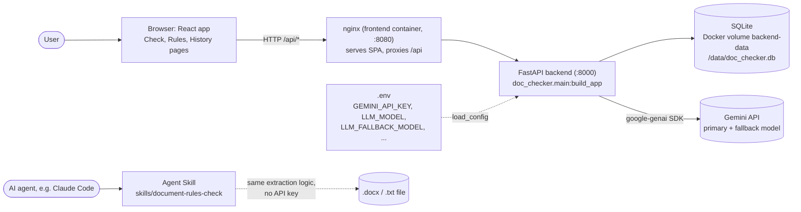
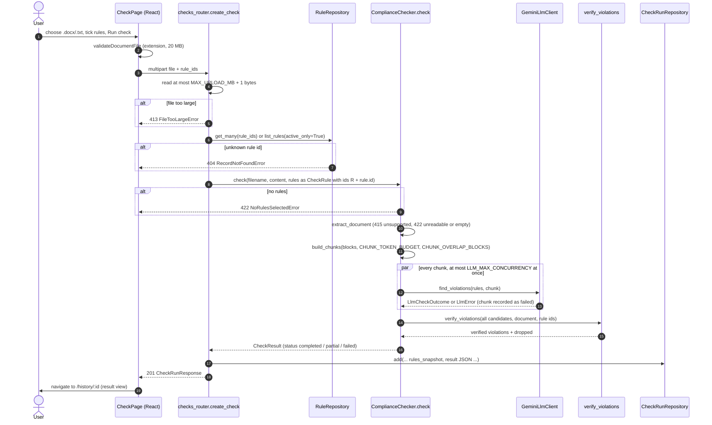
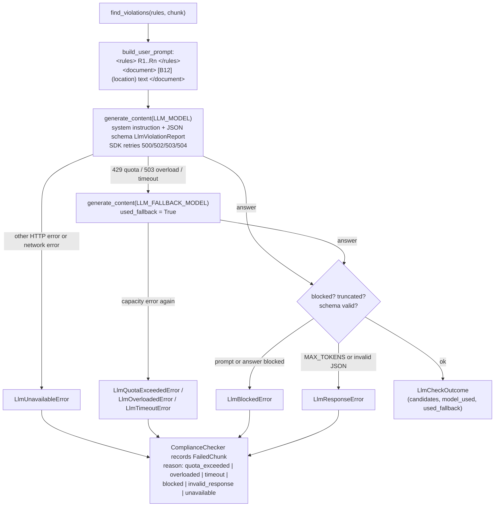
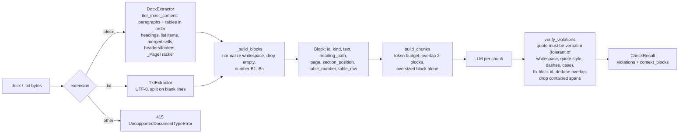
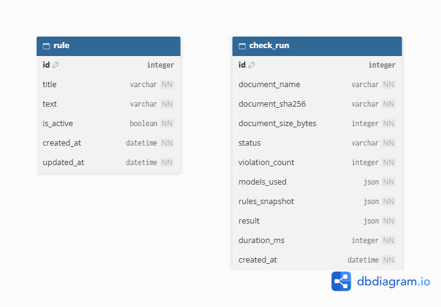
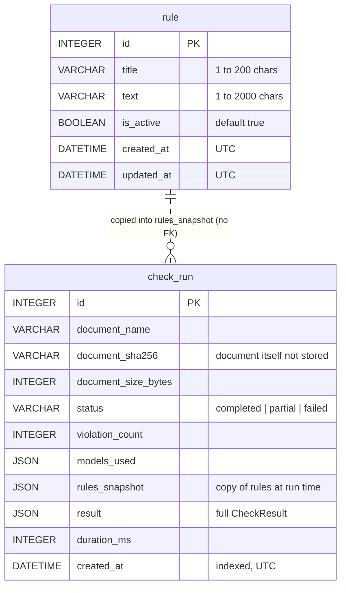
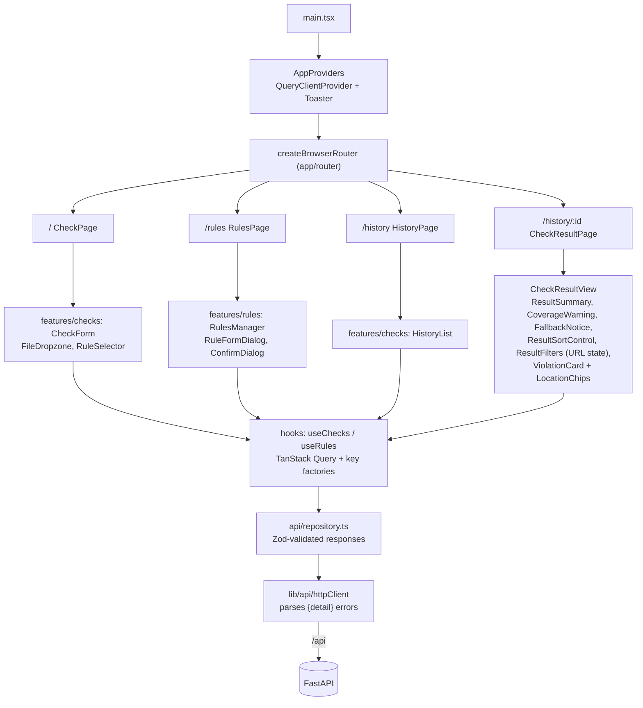
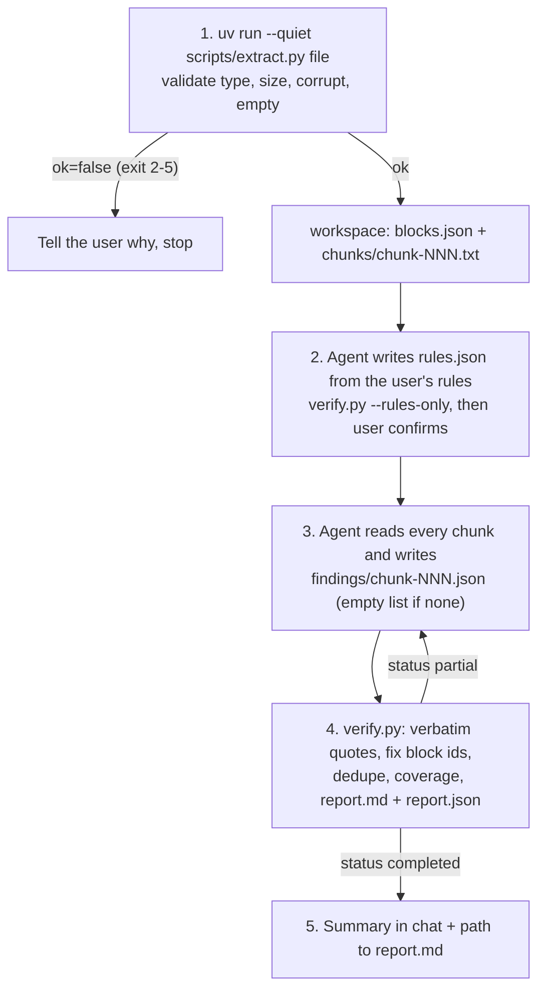

# Architecture

Diagrams are Mermaid (rendered by GitHub; paste any block into https://mermaid.live to edit) and
DBML for the ERD (`erd.dbml`, paste into https://dbdiagram.io). Every name below is a real module,
function or endpoint in this repository.

## Table of Contents

1. [System Overview](#1-system-overview)
2. [Check Request, End to End](#2-check-request-end-to-end)
3. [LLM Call with Fallback](#3-llm-call-with-fallback)
4. [Document Processing Pipeline](#4-document-processing-pipeline)
5. [Data Model (ERD)](#5-data-model-erd)
6. [Frontend Structure](#6-frontend-structure)
7. [Agent Skill Flow](#7-agent-skill-flow)

---

## 1. System Overview

| Component | Location | Responsibility |
|---|---|---|
| Frontend | `frontend/src` (features `rules`, `checks`) | Rules console, upload, results view (sort, filters, location chips), history |
| nginx | `frontend/nginx.conf` | Static files, `/api` proxy, 25 MB body limit, 600 s read timeout |
| API | `backend/src/doc_checker/api` | `health`, `rules` (CRUD), `checks` (upload, history) routers; domain errors to HTTP codes |
| Service | `services/compliance_checker.py` | Orchestrates one check |
| Persistence | `repository/` | SQLModel tables, seeding, repositories |
| Agent Skill | `skills/document-rules-check` | Same check inside an AI agent, scripts for the deterministic parts |

---

## 2. Check Request, End to End

`POST /api/checks` (`api/checks_router.py: create_check`):

Model failures never become "no violations": a failed chunk makes the run `partial` (or `failed`
when every chunk failed) and the run is still stored, so it appears in history with the reason.

---

## 3. LLM Call with Fallback

`llm/gemini_client.py: GeminiLlmClient.find_violations` (one call per chunk):

---

## 4. Document Processing Pipeline

Locations shown to the user come only from facts in the file: section (nearest heading), paragraph
or list-item number among non-empty paragraphs in that section, table number and row as Word counts
them, and the page where the block starts in the layout Microsoft Word saved
(`w:lastRenderedPageBreak`). Files without a saved layout show no page numbers.

---

## 5. Data Model (ERD)

Rendered from `erd.dbml` on dbdiagram.io (no line between the tables: there is no foreign key,
see the note below):

The same model in Mermaid, with the logical (not enforced) relationship drawn as a dotted line:

The dotted line is logical only: there is no foreign key, by design. A run keeps its own copy of
the rules (`rule_id` = `"R" + rule.id`), so history stays correct after rules are edited or deleted.

---

## 6. Frontend Structure

---

## 7. Agent Skill Flow

